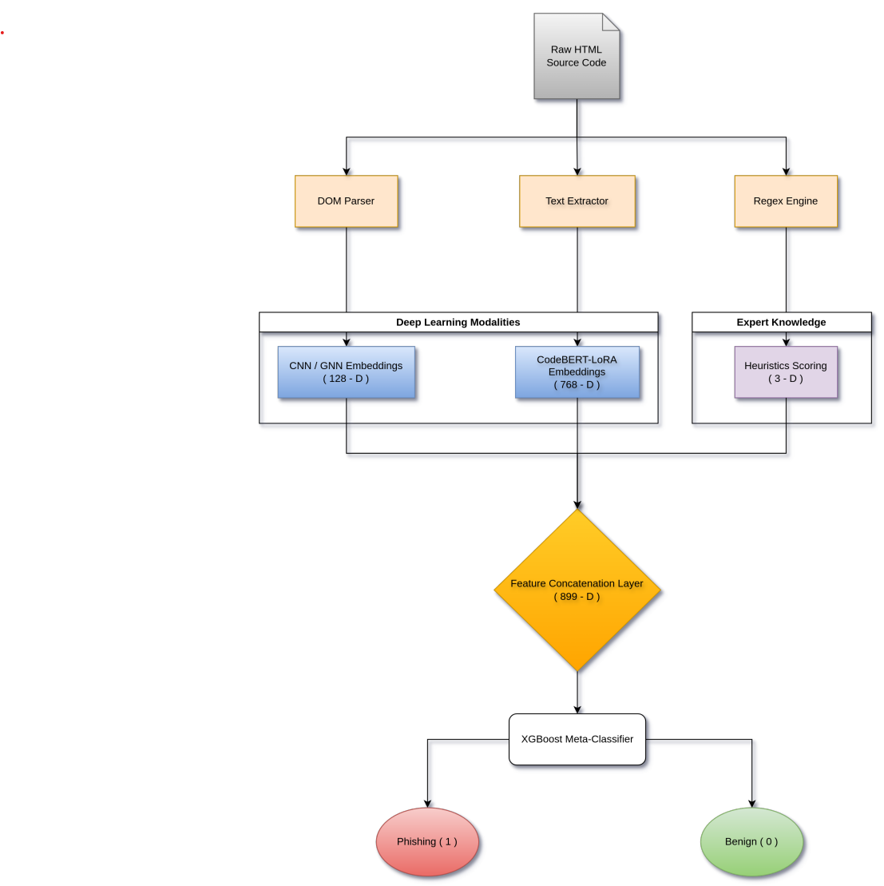

# OmniPhish: A Tri-Modal Stacking Ensemble for Evasive Phishing Detection

[](PASTE_IEEE_XPLORE_LINK_HERE)
[](https://www.python.org/downloads/)
[](https://pytorch.org/)
[](https://opensource.org/licenses/MIT)
[](https://huggingface.co/spaces/XMB480/Omniphish)
[](https://www.kaggle.com/datasets/sulaimaneksambi/omniphish-dataset-v1)

> 📄 **Official IEEE Publication:**
> **[Read the Full Research Paper on IEEE Xplore](PASTE_IEEE_XPLORE_LINK_HERE)** *(Proceedings will be indexed upon publication)*  
> *Accepted & Camera-Ready locked for IEEE Conference Proceedings.*

---

## 📌 Overview

**OmniPhish** is a deep learning stacking ensemble engineered to detect evasive phishing attacks by eliminating domain blindness. Rather than relying on easily manipulated domain names or resource-intensive visual screenshots, OmniPhish evaluates web pages across three synchronized modalities:

1. **DOM Structural Modeling:** Captures hierarchical layout features using 1D Convolutional Neural Network (CNN) or Graph Convolutional Network (GCN) representations.
2. **JavaScript Semantic Intent:** Analyzes client-side script behavior and execution patterns using fine-tuned CodeBERT contextual embeddings.
3. **Behavioral Heuristics:** Rapidly checks critical structural indicators such as form action targets and DOM nesting depth.
4. **Meta-Classification:** An optimized XGBoost meta-learner integrates representations across all three modalities to produce the final classification decision.

> 📖 **Looking for theoretical derivations, mathematical formulation, and ablation studies?**  
> Please consult our **[IEEE Xplore research paper](PASTE_IEEE_XPLORE_LINK_HERE)** for detailed mathematical proofs, latent space balancing formulations, full experimental ablation tables, and baseline comparisons.

---

## 🌐 Public Resources & Artifacts

- **Official Research Paper:** [IEEE Xplore Manuscript](PASTE_IEEE_XPLORE_LINK_HERE)
- **Interactive Live Demo:** [Hugging Face Spaces](https://huggingface.co/spaces/XMB480/Omniphish)
- **Pre-Trained Weights:** [Hugging Face Model Hub](https://huggingface.co/XMB480/OmniPhish-Ensemble)
- **Curated Dataset (7,990 DOM Samples):** [Kaggle Dataset v1](https://www.kaggle.com/datasets/sulaimaneksambi/omniphish-dataset-v1)

---

## 📐 System Architecture



OmniPhish processes web pages directly from raw HTML/DOM and client-side scripts without requiring browser screenshot rendering pipelines, ensuring lightweight and robust operation even against visually disguised attacks.

- **Structural Feature Extractor:** Employs multi-scale 1D-CNN or GCN message-passing layers to extract topological structure.
- **Semantic Code Extractor:** Employs multi-chunk tokenization and global pooling over CodeBERT representations to inspect embedded JavaScript without executing malicious code.
- **Behavioral Indicators:** Extracts explicit risk indicators (suspicious form actions, tree depth).
- **Stacking Meta-Classifier:** Fuses latent feature vectors into an ensemble decision boundary tuned for zero-day phishing discovery.

---

## ⚡ Performance Highlights

Evaluated on an isolated 10% temporal zero-day holdout vault (799 unseen samples: 566 phishing, 233 benign):

- **High Detection Rate:** Achieves up to **98.37% Accuracy** and **99.47% Recall** on zero-day attacks.
- **Ultra-Fast Inference:** Sub-100ms per sample (~93.8 ms/URL), enabling real-time edge or browser-extension deployment.
- **Lightweight Memory Footprint:** Operates within consumer hardware constraints (< 2 GB VRAM on NVIDIA GPUs).

*(For complete statistical tables, ROC/PR curves, and comparative baselines including HTMLPhish, Longformer, and LLM zero-shot agents, please see the published paper.)*

---

## 🛠️ Replication & Setup Guide

### Step 1: Environment Setup

Clone the repository and set up a Python virtual environment:

```bash
git clone https://github.com/sulaimanxmb/OmniPhish-Ensemble.git
cd OmniPhish-Ensemble

# Create and activate virtual environment
python -m venv .venv

# Windows (PowerShell):
.venv\Scripts\Activate.ps1

# Linux / macOS:
source .venv/bin/activate

# Install dependencies
pip install -r requirements.txt
```

> **GPU Acceleration (Recommended for Windows / NVIDIA):**  
> Install the CUDA-enabled PyTorch build matching your NVIDIA driver:
> ```bash
> pip install torch torchvision torchaudio --index-url https://download.pytorch.org/whl/cu121
> ```

---

### Step 2: Dataset Setup

Download the curated **7,990 post-rendered DOM dataset** from [Kaggle](https://www.kaggle.com/datasets/sulaimaneksambi/omniphish-dataset-v1) and place the HTML files into the following directory structure:

```
dataset/
└── raw_html/
    ├── benign/     # 2,250 Benign HTML files (sampled from Tranco Top 1M)
    └── phishing/   # 5,740 Phishing HTML files (captured via OpenPhish threat feeds)
```

Verify dataset integrity:
```bash
python -c "import os; p=len(os.listdir('dataset/raw_html/phishing')); b=len(os.listdir('dataset/raw_html/benign')); print(f'Dataset Verified: {p} Phishing, {b} Benign (Total: {p+b})')"
```

---

### Step 3: Running OmniPhish

#### A. Automated Master Pipeline (Recommended)
Run the automated orchestration script to train and evaluate CNN and GNN models end-to-end:
```bash
python run_pipeline.py
```
- Select `[1]` to run both CNN and GNN, or `[4]` to evaluate existing checkpoints directly.
- Choose between **Fast Mode** (pre-extracted representations) or **Slow Mode** (isolated fold-by-fold fine-tuning).

#### B. Single URL Live Inference
Run inference directly against an online webpage:
```bash
python predict.py --url https://example.com
```

#### C. Interactive Research Dashboard
Launch the local web dashboard for interactive exploration of metrics and visualizations:
```bash
python dashboard/server.py
```
Then navigate to `http://localhost:5067` in your browser.

#### D. Generate Publication Figures
Generate ROC curves, Precision-Recall curves, feature importance charts, and confusion matrices:
```bash
python scripts/visualization/generate_visualizations.py --model both
```

---

## 📂 Project Structure

```
OmniPhish-Ensemble/
├── Paper.pdf                             # Camera-Ready IEEE Conference Publication
├── README.md                             # Documentation & replication manual
├── requirements.txt                      # Python dependencies
├── run_pipeline.py                       # Automated master pipeline runner
├── predict.py                            # Single-URL live inference CLI
├── omniphish/                            # Core neural network modules & feature extractors
│   ├── classifier.py                     # MetaClassifier (Optuna XGBoost)
│   ├── cnn_model.py                      # 1D-CNN structural modeling
│   ├── gnn_model.py                      # Graph Convolutional Network (GCN) modeling
│   ├── dataset_loader.py                 # Multi-modal HTML parser & PyTorch DataLoader
│   ├── html_parser.py                    # Tag cleaning & token sanitization
│   ├── transformer_model.py              # CodeBERT LoRA feature extractor
│   └── url_heuristics.py                 # DOM behavioral heuristics
├── scripts/
│   ├── training/                         # Training, ablation, and validation scripts
│   │   ├── trainer.py                    # 1D-CNN training & Optuna cross-validation
│   │   ├── gnn_trainer.py                # GNN training & Optuna cross-validation
│   │   ├── Check_for_overfitting.py      # Holdout vault evaluator
│   │   └── ablation_study.py             # Synergy ablation experiments
│   └── visualization/
│       └── generate_visualizations.py    # ROC, PR, SHAP, and PCA plotting suite
├── baselines/                            # Comparative baseline implementations
│   ├── htmlphish_trainer.py              # Pure Structural CNN (HTMLPhish)
│   ├── longformer_trainer.py             # Sparse Transformer (Longformer 4096)
│   └── llm_zeroshot_baseline.py          # LLM Zero-Shot baseline (Qwen2.5-Coder)
├── dashboard/                            # Local FastAPI research dashboard (Port 5067)
├── visualizations/                       # Publication graphics & evaluation charts
└── metrics/                              # Canonical evaluation logs & vault prediction outputs
```

---

## 📜 Citation

If you find OmniPhish useful in your academic or applied security research, please cite our IEEE conference publication:

```bibtex
@inproceedings{omniphish2026,
  author    = {Mohammed Sulaiman Eksambi and Dushanth Purushotham D and Numan Nisar Ahmed and Sumathi D and Devi Priya V S},
  title     = {OmniPhish: A Tri-Modal Stacking Ensemble for Evasive Phishing Detection},
  booktitle = {Proceedings of the IEEE Conference},
  year      = {2026},
  url       = {PASTE_IEEE_XPLORE_LINK_HERE}
}
```

---

## 📄 License

This project is licensed under the MIT License — see the [LICENSE](LICENSE) file for details.
