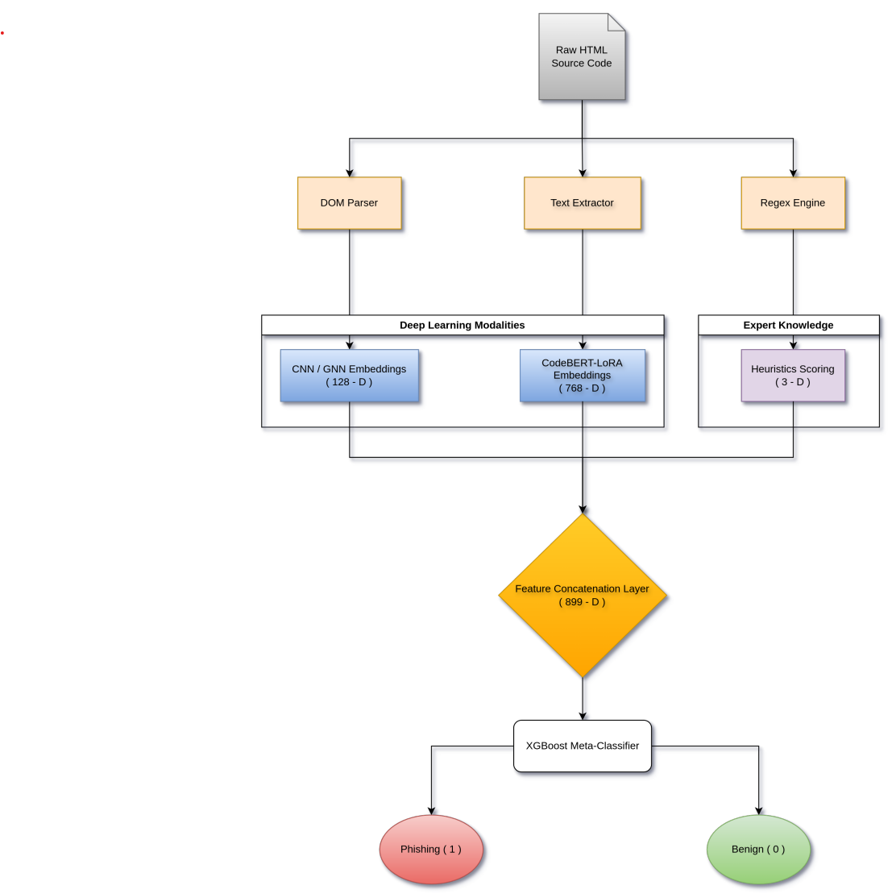

# OmniPhish: A Tri-Modal Stacking Ensemble for Evasive Phishing Detection

[](https://www.python.org/downloads/)
[](https://pytorch.org/)
[](https://opensource.org/licenses/MIT)
[](https://huggingface.co/spaces/XMB480/Omniphish)
[](https://www.kaggle.com/datasets/sulaimaneksambi/omniphish-dataset-v1)

Official implementation of **OmniPhish**, a Deep Learning Stacking Ensemble that mitigates "Domain Blindness" in modern web security by fusing Document Object Model (DOM) structural sequence modeling, isolated client-side JavaScript semantic intent analysis, and explicit DOM behavioral heuristics.

---

## 🌐 Public Resources & Artifacts

- **Live Interactive Web Demo:** [Hugging Face Spaces](https://huggingface.co/spaces/XMB480/Omniphish)
- **Pre-Trained Weights:** [Hugging Face Model Hub](https://huggingface.co/XMB480/OmniPhish-Ensemble)
- **Curated Research Dataset (7,990 DOM Samples):** [Kaggle Dataset v1](https://www.kaggle.com/datasets/sulaimaneksambi/omniphish-dataset-v1)
- **Publication Status:** IEEE Conference Accepted (Camera-Ready locked; proceedings will be indexed via IEEE Xplore)

---

## 📐 Architecture Overview



OmniPhish bypasses resource-heavy visual rendering and screenshot pipelines, operating directly on post-rendered DOM hierarchies and client-side execution logic:

1. **Spatial / Relational Structural Analysis (128-D):**
   - **1D-CNN Variant:** Multi-scale 1D Convolutional Neural Network (kernel sizes 3, 4, 5) scanning DOM tag sequences.
   - **GNN Variant:** Graph Convolutional Network (GCN) modeling the DOM tree as a connected relational graph.
2. **Isolated JavaScript Semantic Intent (768-D):**
   - Pre-trained **CodeBERT** fine-tuned via Low-Rank Adaptation (LoRA, rank $r=8$, $\alpha=32$) exclusively on extracted JavaScript logic.
   - Multi-chunk tokenization with **1D Global Max Pooling (GMP)** over classification tokens ($\mathbf{h}_{\text{CLS}}^{(c)}$) to eradicate evasion by dead-code padding.
3. **Explicit DOM Behavioral Heuristics (3-D):**
   - Externalized form action flags (`Heur_Suspicious_Action`), maximum DOM tree depth (`Heur_DOM_Depth`), and URL / nesting scores (`Heur_URL_Score`).
4. **Meta-Classification & Spatial Memory Balancing:**
   - Unified **899-dimensional** feature vector classified by an **Optuna-optimized XGBoost Meta-Classifier**.
   - Synthetic Minority Over-sampling Technique (**SMOTE**) applied post-concatenation in the joint 899-D latent space following Standard Scaling to resolve class imbalance without data leakage.

---

## 📊 Benchmark Results

### 1. Zero-Day Holdout Vault Performance (Table I)
Evaluated on an isolated 10% quasi-stratified temporal zero-day split (**799 samples: 566 phishing, 233 benign**; ~2.43:1 ratio) strictly unseen during model training and hyperparameter tuning:

| Model Architecture | Accuracy | Precision | Recall | F1-Score | Missed Attacks (FN / 566) | False Alarms (FP / 233) | Peak VRAM | Inference Latency |
| :--- | :---: | :---: | :---: | :---: | :---: | :---: | :---: | :---: |
| **OmniPhish CNN (Proposed)** | **98.37%** | **98.25%** | **99.47%** | **98.86%** | **3 (0.53% FNR)** | **10** | **1.80 GB** | **93.79 ms/URL** |
| Long-Context Semantic (Longformer 4096) | 94.24% | 94.07% | 98.06% | 96.02% | 11 | 35 | 11.56 GB | ~2,500 ms/URL |
| **OmniPhish GNN (Proposed)** | **93.24%** | **93.10%** | **97.70%** | **95.34%** | **13 (2.30% FNR)** | **41** | **2.96 GB** | **95.28 ms/URL** |
| Pure Structural CNN (HTMLPhish) | 91.24% | 92.03% | 95.94% | 93.94% | 23 | 47 | 0.64 GB | ~45.00 ms/URL |
| LLM Zero-Shot (Qwen2.5-Coder 14B) | 47.68% | 94.58% | 27.74% | 42.90% | 409 | 9 | ~9.50 GB | ~4,200 ms/URL |

### 2. Architectural Ablation Study (Table II)
Evaluates the theoretical upper-bound synergy across modalities trained on 100% of non-vault data:

| Architecture Variant | Ablated Modality | F1-Score | Precision | Recall | MCC |
| :--- | :--- | :---: | :---: | :---: | :---: |
| **OmniPhish CNN** | No CodeBERT (CNN + Heur) | 99.21% | 99.47% | 98.95% | 0.9727 |
| | No CNN (CodeBERT + Heur) | 96.25% | 97.82% | 94.73% | 0.8760 |
| | No Heur (CNN + CodeBERT) | 99.21% | 99.65% | 98.77% | 0.9728 |
| | **FULL CNN ENSEMBLE** | **99.21%** | **99.65%** | **98.77%** | **0.9728** |
| **OmniPhish GNN** | No CodeBERT (GNN + Heur) | 88.95% | 90.96% | 87.02% | 0.6240 |
| | No GNN (CodeBERT + Heur) | 95.91% | 96.50% | 95.33% | 0.8546 |
| | No Heur (GNN + CodeBERT) | 95.40% | 95.65% | 95.16% | 0.8350 |
| | **FULL GNN ENSEMBLE** | **95.40%** | **95.81%** | **94.98%** | **0.8355** |

### 3. Cross-Validation Stability
- **OmniPhish CNN 5-Fold Validation F1:** $98.86\% \pm 2.10\%$
- **OmniPhish GNN 5-Fold Validation F1:** $95.90\% \pm 0.30\%$ (demonstrating extreme topological cross-fold stability)

---

## 🛠️ Step-by-Step Replication Guide

### Step 1: Environment Setup

Clone the repository and install dependencies in a clean virtual environment:

```bash
git clone https://github.com/sulaimanxmb/OmniPhish-Ensemble.git
cd OmniPhish-Ensemble

# Create and activate virtual environment
python -m venv .venv
# Windows (PowerShell):
.venv\Scripts\Activate.ps1
# Linux / macOS:
source .venv/bin/activate

# Install dependencies
pip install -r requirements.txt
```

> **GPU Acceleration Note:** To enable CUDA hardware acceleration on NVIDIA GPUs, install the CUDA-enabled PyTorch build matching your driver:
> ```bash
> pip install torch torchvision torchaudio --index-url https://download.pytorch.org/whl/cu121
> ```

---

### Step 2: Dataset Setup

Download the curated **7,990 post-rendered DOM dataset** from [Kaggle](https://www.kaggle.com/datasets/sulaimaneksambi/omniphish-dataset-v1) and place the HTML files into the following directory structure:

```
dataset/
└── raw_html/
    ├── benign/     # 2,250 Benign HTML files (sampled from Tranco Top 1M)
    └── phishing/   # 5,740 Phishing HTML files (captured via OpenPhish threat feeds)
```

Verify dataset integrity:
```bash
python -c "import os; p=len(os.listdir('dataset/raw_html/phishing')); b=len(os.listdir('dataset/raw_html/benign')); print(f'Dataset Verified: {p} Phishing, {b} Benign (Total: {p+b})')"
```

---

### Step 3: Reproduce Results

You can reproduce all experiments either through the **automated master pipeline** or via **modular component execution**:

#### Option A: Automated Master Pipeline (Recommended)

Run the unattended master orchestration script:
```bash
python run_pipeline.py
```
- **Select Execution Mode:** Choose `[1]` to train and evaluate both CNN and GNN ensembles, or `[4]` to skip training and evaluate existing checkpoints directly.
- **Select Training Mode:**
  - `[1] FAST MODE`: Pre-extracts global CodeBERT embeddings once (~15 minutes on modern GPUs).
  - `[2] SLOW MODE`: Strict fold-by-fold CodeBERT LoRA fine-tuning with zero feature leakage (~2 hours).
- **Select Visualizations:** Enter `A` to generate all mathematical plots (ROC, PR, SHAP, t-SNE, SMOTE PCA, Confusion Matrices).

---

#### Option B: Modular Step-by-Step Execution

1. **Train the 1D-CNN Stacking Ensemble:**
   ```bash
   python scripts/training/trainer.py
   ```
   Locks the 10% holdout vault into `weights/vault_files.json`, conducts 5-Fold Cross Validation with Optuna hyperparameter optimization, and saves weights to `weights/` and `weights_cnn/`.

2. **Train the GNN Stacking Ensemble:**
   ```bash
   python scripts/training/gnn_trainer.py
   ```
   Executes graph convolution message passing across the DOM relational trees and saves weights to `weights_gnn/`.

3. **Evaluate the Decoupled Zero-Day Holdout Vault:**
   ```bash
   # Evaluate CNN Model
   python scripts/training/Check_for_overfitting.py --model cnn

   # Evaluate GNN Model
   python scripts/training/Check_for_overfitting.py --model gnn
   ```
   Outputs exact Accuracy, Precision, Recall, F1-Score, ROC-AUC, and Confusion Matrix metrics against the unseen zero-day vault.

4. **Reproduce the Architectural Ablation Study (Table II):**
   ```bash
   # Run CNN Ablations (No CodeBERT, No CNN, No Heuristics, Full Ensemble)
   python scripts/training/ablation_study.py --model cnn

   # Run GNN Ablations (No CodeBERT, No GNN, No Heuristics, Full Ensemble)
   python scripts/training/ablation_study.py --model gnn
   ```

5. **Evaluate Independent SOTA Baselines:**
   ```bash
   # 1. Pure Structural CNN (HTMLPhish)
   python baselines/htmlphish_trainer.py

   # 2. Long-Context Transformer (Longformer 4096)
   python baselines/longformer_trainer.py

   # 3. LLM Zero-Shot Baseline (Qwen2.5-Coder:14B)
   # Requires Ollama running in the background: ollama run qwen2.5-coder:14b
   python baselines/llm_zeroshot_baseline.py
   ```

6. **Generate Publication Visualizations:**
   ```bash
   python scripts/visualization/generate_visualizations.py --model both
   ```
   - Enter `0` for the Baseline Comparison bar chart (`baseline_comparison.pdf`).
   - Enter `1` for the XGBoost Feature Importance plot (`cnn_xgboost_importance.pdf`, `gnn_xgboost_importance.pdf`).
   - Enter `C` for Combined ROC and Precision-Recall Curves (`combined_roc_curve.pdf`, `combined_pr_curve.pdf`).
   - Enter `A` to generate all high-resolution figures in `Visualizations/`.

7. **Launch the Interactive Research Dashboard:**
   ```bash
   python dashboard/server.py
   ```
   Open your browser to [http://localhost:5067](http://localhost:5067) to view the interactive metrics comparison, ablation breakdown, and high-resolution artifact gallery.

8. **Live URL Single-Sample Prediction:**
   ```bash
   python predict.py --url https://example.com
   ```

---

## 🔒 Exact Reproducibility Guarantee

To eradicate stochastic variance across different operating systems and CPU thread schedulers, the following controls are strictly enforced:

- **Master Seed `42`**: Applied across Python `random.seed(42)`, `numpy.random.seed(42)`, `torch.manual_seed(42)`, and Optuna `TPESampler(seed=42)`.
- **Deterministic PyTorch Operations**: `torch.backends.cudnn.deterministic = True`, `torch.backends.cudnn.benchmark = False`, and `os.environ['CUBLAS_WORKSPACE_CONFIG'] = ':4096:8'`.
- **Worker Seed Synchronization**: PyTorch DataLoader processes use `worker_init_fn=seed_worker` with fixed `torch.Generator()` seeds.
- **Persistent Vault Synchronization**: The exact 799 holdout URLs are saved to `weights/vault_files.json`, ensuring every baseline and ensemble variant tests on the exact identical zero-day samples.

---

## 📂 Project Structure

```
OmniPhish-Ensemble/
├── Paper.tex                             # Camera-Ready IEEE Conference Manuscript source
├── Paper.pdf                             # Compiled publication PDF
├── README.md                             # Documentation & replication manual
├── requirements.txt                      # Complete Python dependency specification
├── run_pipeline.py                       # Automated master pipeline runner
├── predict.py                            # Standalone single-URL live inference CLI
├── omniphish/                            # Core neural architectures & feature extractors
│   ├── classifier.py                     # MetaClassifier (Optuna XGBoost + Logistic Regression)
│   ├── cnn_model.py                      # Multi-scale 1D-CNN structural embedding
│   ├── dataset_loader.py                 # HTML parser, DOM depth, and PyTorch dataset
│   ├── gnn_model.py                      # Graph Convolutional Network (GCN) embedding
│   ├── html_parser.py                    # Tag cleaning, text extraction, and CodeBERT sanitizer
│   ├── transformer_model.py              # CodeBERT LoRA feature extractor with 1D GMP
│   └── url_heuristics.py                 # Domain, form action, and nesting heuristics
├── scripts/
│   ├── training/
│   │   ├── trainer.py                    # 1D-CNN training & Optuna cross-validation
│   │   ├── gnn_trainer.py                # GNN training & Optuna cross-validation
│   │   ├── Check_for_overfitting.py      # Holdout vault evaluator & confusion matrix generator
│   │   └── ablation_study.py             # Tri-modal synergy ablation benchmark
│   └── visualization/
│       ├── generate_visualizations.py    # Master visualization suite (SHAP, ROC, PR, PCA)
│       └── convert_arch.py               # Diagram conversion utility
├── baselines/                            # State-of-the-Art comparative models
│   ├── htmlphish_trainer.py              # Pure Structural CNN (HTMLPhish baseline)
│   ├── longformer_trainer.py             # Sparse Transformer (Longformer 4096 baseline)
│   └── llm_zeroshot_baseline.py          # Large Language Model (Qwen2.5-Coder 14B baseline)
├── dashboard/                            # Local interactive research web dashboard
│   ├── server.py                         # FastAPI dashboard backend (Port 5067)
│   └── templates/index.html              # Responsive interactive metrics interface
├── Visualizations/                       # High-resolution PDF publication graphics
│   ├── Architecture.pdf                  # Tri-Modal system overview (Figure 2)
│   ├── baseline_comparison.pdf           # F1-Score vs Peak VRAM comparison (Figure 3)
│   ├── cnn_smote_pca_comparison.pdf      # Fold-specific SMOTE PCA balancing (Figure 1)
│   ├── combined_roc_curve.pdf            # ROC Curves for CNN & GNN (Figure 4)
│   ├── cnn_xgboost_importance.pdf        # XGBoost Feature Importance for CNN (Figure 5)
│   └── gnn_xgboost_importance.pdf        # XGBoost Feature Importance for GNN (Figure 6)
└── metrics/                              # Canonical evaluation logs & predicted probabilities
    ├── kfold_variance_logs.csv           # 5-Fold cross-validation variance logs
    ├── y_probs_cnn.npy                   # Saved probability outputs for CNN vault
    ├── y_probs_gnn.npy                   # Saved probability outputs for GNN vault
    ├── y_true_cnn.npy                    # True binary labels for CNN vault
    └── y_true_gnn.npy                    # True binary labels for GNN vault
```

---

## 📜 Citation

If you find OmniPhish helpful in your security research or benchmark comparisons, please cite our manuscript:

```bibtex
@inproceedings{omniphish2026,
  author    = {Mohammed Sulaiman Eksambi and Dushanth Purushotham D and Numan Nisar Ahmed and Sumathi D and Devi Priya V S},
  title     = {OmniPhish: A Tri-Modal Stacking Ensemble for Evasive Phishing Detection},
  booktitle = {Proceedings of the IEEE Conference},
  year      = {2026}
}
```

---

## 📄 License

This project is licensed under the MIT License — see the [LICENSE](LICENSE) file for details.
